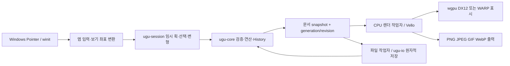

# Ugurugu 3.0 Rust 재작성 분석 보고서

작성일: 2026-10-12 (Asia/Seoul). Rust 분석 대상은 `rust/m6-finish`, 커밋 `b809009de58185281b1612aea5e51a4d4173f401`이다. 비교 대상은 C++/Qt `v2.2.13`이며, `git diff v2.2.13 -- src`가 비어 현재 작업 트리의 `src/`를 비교에 사용했다. Rust는 별도 `rust/` 디렉터리가 아니라 루트 Cargo workspace의 `apps/`, `crates/`에 있다. **제품 소스·설정·의존성을 수정하지 않았으며, 이 보고서만 추가한다.** 검사 로그와 재현용 파일은 Git에서 제외되는 `target/analysis-3.0/`에 남겼다.

근거의 `경로:줄`은 위 커밋의 저장소 루트 기준이다. **확인됨**은 현재 소스 또는 이번 실행으로 확인한 사실, **추정**은 실행하지 않은 조건의 영향·성능 예상·개선 제안이다. 실행 확인과 정적 확인은 별도로 적었다. GUI를 직접 실행·조작하지 않았으므로 **UI/UX 평가는 코드에서 읽어낸 내용**이다. 기존 GUI·장치 시험 기록을 인용할 때는 이번 실행과 구분한다.

## 1. 요약

**3.0은 주요 드로잉 기능을 갖춘 Windows 재작성판이지만, 2.2.13의 완전 호환 대체판은 아니다.** 코어와 편집 세션의 의존성 분리, 공유 데이터와 역연산 기반 이력, 원자적 저장, 렌더·인코더 회귀 시험은 강점이다. 이번 workspace 빌드와 release 테스트는 통과했고 **502개 통과·0개 실패·3개 제외**였다. Pedantic Clippy는 완료됐으나 경고가 많다. `.ugu`는 제한된 읽기 변환이며, 새 `.ugurugu`를 C++로 되돌려 여는 경로는 없다. Qt는 Rust 앱의 의존 경로에서 제거됐지만 libwebp 등 네이티브 코드까지 없어진 것은 아니다. 근거: `Cargo.toml:12`, `crates/ugu-core/Cargo.toml:9`, `crates/ugu-core/src/history.rs:4`, `crates/ugu-io/src/save.rs:86`, `docs/rust/scope.md:52`, 아래 3.4·3.5의 실행 결과.

우선 처리할 문제 다섯 가지는 다음과 같다.

1. **High / 확인됨·실행:** 해시가 일치하는 잘못된 PNG 또는 크기가 맞지 않는 내장 이미지를 정상 프로젝트로 읽고, 렌더에서는 이미지 없이 성공한다. 저장된 그림의 신뢰성 문제다. `crates/ugu-io/src/read.rs:294`, `crates/ugu-render/src/document.rs:1797`, 3.6 A-01.
2. **High / 확인됨·정적:** 복구 메타데이터가 모두 없거나 읽히지 않으면 정상 `.ugurugu`가 남아 있어도 폴더를 삭제한다. 첫 복구 쓰기 도중 중단하는 경우도 보호해야 한다. `apps/ugurugu/src/recovery.rs:132`, `:164`, `:181`, 3.6 A-02.
3. **High / 확인됨·정적, 영향 추정:** WARP 자동 전환은 어댑터 탐색 실패만 처리한다. 하드웨어 device 생성 실패는 오류가 전파돼 실행·장치 복구에 실패할 수 있다. `crates/ugu-render/src/gpu.rs:48`, `:69`, `:166`, 3.6 A-03.
4. **Medium / 확인됨·정적, 영향 추정:** 파일 작업자 채널의 송신 실패를 무시한다. 작업자가 종료되면 저장·열기 진행 상태가 해제되지 않을 가능성이 있다. `apps/ugurugu/src/files.rs:374`, `:646`, `:762`, `:1176`, 3.6 A-04.
5. **Medium / 확인됨:** README가 2.x와 3.0의 형식·단축키·GPU 조건을 섞어 안내한다. 호환 축소와 작업 흐름 변경을 먼저 명확히 알려야 한다. `README.md:22`, `:50`, `:78`, `:113`, `:143`; `apps/ugurugu/src/shortcuts.rs:292`.

현재 검토에서 Critical로 분류할 새 결함은 확인하지 못했다. 이것이 모든 데이터 손실·장치 문제의 부재를 뜻하지는 않는다. 실제 펜·터치, 다양한 GPU, macOS 3.0은 이번 검사로 검증되지 않았다.

## 2. C++ ↔ Rust 기능 정합성 매트릭스

아래 표는 **확인됨·정적 분석**을 기준으로 한다. **동일**은 명시된 기능·정책이 대응한다는 뜻이며, 모든 픽셀·입력 감촉이 같다는 뜻은 아니다. **누락(범위 제외)**는 사용자의 비교 기준에는 없어진 기능이지만, 저장소에 명시된 3.0 범위상 의도한 결정이다. 이전 계획은 현재 요청을 제한하는 지시가 아니라 분석 대상 자료로만 사용했다. 근거: `docs/rust/scope.md:39`, `:94`.

| 기능 | C++ 2.2.13 | Rust 3.0 | 상태 | 근거 |
|---|---|---|---|---|
| 작업 파일 저장·열기 | `.ugu` 저장·열기 | `.ugurugu` 저장·열기, `.ugu` 읽기 변환 | 차이 | `src/io/DocumentSerializer.cpp:719`; `crates/ugu-io/src/format.rs:43`; `apps/ugurugu/src/files.rs:694`; 상세 2.1 |
| 구형 `.ugu` | 여러 스키마를 읽는 구형 경로 유지 | schema 13만 변환; 구형은 2.2.13 재저장 필요 | 차이 | `docs/rust/scope.md:52`; `docs/rust/ugu-import.md:1`; 상세 2.1 |
| `.wagle`·`.wobble` | 이전 프로젝트 열기 | 지원하지 않는 구형 형식으로 판별 | 누락(범위 제외) | `README.md:78`; `crates/ugu-io/src/tests.rs:447`; `docs/rust/scope.md:94` |
| WiggleWiggleTool `.wawa` | 전용 v10 importer | 직접 가져오기 없음 | 누락(범위 제외) | `src/ui/MainWindow.cpp:317`; `README.md:113`; `docs/rust/scope.md:94` |
| `.wwpreset` | 공유 프리셋 형식 | 읽기 없음; `.ugurugu-tools` JSON으로 도구·모션 공유 | 차이, 구형 읽기 누락 | `docs/rust/scope.md:50`; `apps/ugurugu/src/settings/preset.rs:20`; `README.md:79` |
| Classic·Smooth·Stepped, 끊어진 선 | 세 모션·끊김 효과 | 같은 모션 분기와 조절 항목 | 동일(기능), 출력 완전 동일은 아님 | `src/render/StrokeMotionModel.cpp:158`; `crates/ugu-core/src/motion.rs:283`; 상세 2.2 |
| 도구 17종 | 도구 모드 7개, 기본 브러시 프리셋 17개·지우개 3개 | 같은 모드·기존 프리셋 + 픽셀 연필·픽셀 지우개 | 동일 + Rust에만 있음 | `src/ui/CanvasTypes.hpp:9`; `src/brush/BrushPreset.cpp:80`; `src/brush/EraserPreset.cpp:56`; `crates/ugu-session/src/lib.rs:45`; `crates/ugu-core/src/brush.rs:111`, `:188` |
| 필압·필압 끄기·펜 지우개 | 지원 | Pointer 필압 유효성 검사·정규화, 사용 여부 설정·펜 뒤집기 | 동일(코드 경로) | `src/ui/CanvasWidgetTools.cpp:32`, `:170`; `crates/ugu-win/src/pointer.rs:466`; `crates/ugu-session/src/lib.rs:432`, `:741`; `apps/ugurugu/src/canvas.rs:971` |
| 손떨림 보정 | 1 Euro 필터 | 같은 알고리즘·cutoff/beta 상수 | 동일(알고리즘) | `src/input/StrokeStabilizer.cpp:16`; `crates/ugu-session/src/stabilizer.rs:10` |
| 자유·사각·타원 선택, 추가·빼기 | 지원 | 지원, 선택 반전·해제 | 동일 | `src/ui/CanvasTypes.hpp:33`; `crates/ugu-session/src/selecting.rs:23`, `:133` |
| 자동 선택·페인트 통 | 활성/참조/표시 레이어, 알파/색상 비교 | 같은 참조·비교 방식 | 동일(기능) | `src/ui/CanvasTypes.hpp:20`; `crates/ugu-session/src/filling.rs:21`, `:44`; `apps/ugurugu/src/ui/mod.rs:477` |
| 선택 이동·크기·회전 | 이동·반전, 확대율·각도 수치 입력 | 직접 핸들로 이동·크기·회전, 대응 수치 입력 없음 | 차이 | `src/ui/MainWindow.cpp:1277`, `:1294`; `apps/ugurugu/src/canvas/transform.rs:118`, `:164`; `apps/ugurugu/src/ui/mod.rs:898` |
| 레이어·그룹·불투명도·합성 | Normal/Multiply/Screen/Overlay, 클리핑·참조 | 같은 주요 속성, 그룹 접기 제공 | 동일 + Rust에만 있음(그룹 접기) | `src/ui/LayerDock.cpp:213`, `:232`, `:374`; `apps/ugurugu/src/ui/layers.rs:31`, `:158`, `:416`, `:765` |
| 레이어별 우글거림 | 전역/활성 레이어 설정, 켬·끔 | 대응 범위와 override | 동일(기능) | `src/ui/WobbleDock.cpp:37`, `:69`; `apps/ugurugu/src/ui/mod.rs:1066`; `crates/ugu-core/src/ops.rs:263` |
| 이미지·문자 배치, 캔버스 자르기·크기 | 지원 | 이미지·문자 윤곽, 순서가 있는 crop/resample 연산 | 동일(기능), 파일 변환 제약 있음 | `src/ui/MainWindow.cpp:1104`, `:1150`, `:1635`; `crates/ugu-session/src/placing.rs:77`; `crates/ugu-text/src/lib.rs:63`; `crates/ugu-core/src/ops.rs:214`; `apps/ugurugu/src/ui/resize.rs:259`; 상세 2.1 |
| 그리는 중 재생 | 일시정지/계속 재생 선택 | 획 시작 시 재생 종료, 자동 재개 없음 | 차이·기존 옵션 누락 | `src/ui/SettingsDialog.cpp:168`; `src/ui/CanvasWidgetPreview.cpp:780`, `:1722`; `apps/ugurugu/src/ui/settings.rs:4`; `apps/ugurugu/src/canvas.rs:546`, `:967`, `:1038` |
| GIF 애니메이션 | 프레임·크기·투명 옵션 | 대응 + 정수배 확대 | 동일 + Rust 확장 | `src/io/ExportWorker.cpp:277`, `:304`; `apps/ugurugu/src/export.rs:37`, `:59`, `:420`; `crates/ugu-io/src/gif.rs:670` |
| Animated WebP | lossless, 무한 반복 | 대응, 병렬 인코딩 run 결합 | 동일(표현 정책), 내부 방식 차이 | `src/io/WebPWriter.cpp:173`, `:189`; `crates/ugu-io/src/webp.rs:148`, `:337`, `:453`, `:548` |
| PNG | 현재 프레임·알파 | RGBA8 PNG·알파, sRGB 정보 기록 | 동일(기능) | `src/io/ExportWorker.cpp:212`, `:249`; `apps/ugurugu/src/export.rs:292`; `crates/ugu-io/src/image.rs:28` |
| JPG/JPEG | 흰 배경으로 알파 합성, 품질 92 | 같은 정책 | 동일 | `src/io/ExportWorker.cpp:221`, `:252`; `crates/ugu-io/src/image.rs:48`, `:187`, `:200` |
| 투명 출력 | PNG/WebP 알파, GIF 제한적 투명; JPG 불가 | 같은 제약 | 동일 | `crates/ugu-io/src/gif.rs:114`; `crates/ugu-io/src/image.rs:28`, `:187`; `src/io/ExportWorker.cpp:221` |
| 패널 도킹·배치 저장 | Qt 도킹·탭·복원 | 자체 도킹·탭·좌우/부동 패널·크기·JSON 저장 | 동일(기능) | `src/ui/PaletteDockAreaManager.cpp:71`; `src/ui/MainWindow.cpp:247`; `apps/ugurugu/src/layout.rs:4`; `apps/ugurugu/src/ui/dock.rs:192`, `:513`; `apps/ugurugu/src/settings.rs:268` |
| 단축키 변경 | 개별 키 변경 | 액션 키 변경·충돌 거부, 일부 고정 제스처 제외 | 동일(범위에 주의), 기본값 차이 | `src/ui/SettingsDialog.cpp:245`; `apps/ugurugu/src/shortcuts.rs:91`, `:292`, `:319`, `:360` |
| ko/en/ja | Qt 번역 | Fluent 3종·fallback, 일부 원문 오류 잔존 | 동일(언어), 완성도 차이 | `src/ui/InterfaceTranslators.cpp:15`; `apps/ugurugu/src/i18n.rs:17`, `:199`; `apps/ugurugu/src/canvas.rs:952` |
| 크래시 복구 | 30초 저장, 단일 복구 파일 | 창별 잠금·2세대, 정지 3초/연속 30초, 로그·다음 시작 안내 | 차이·개선, 경계 결함 있음 | `src/ui/MainWindow.cpp:237`; `src/app/RecoveryStore.cpp:189`; `apps/ugurugu/src/recovery.rs:4`, `:19`, `:112`; A-02 |
| 자동 업데이트 | Windows Velopack, macOS Sparkle | Windows Velopack, 별도 3.0 앱·채널·자동 확인 해제 | 동일(Windows), 플랫폼 차이 | `src/app/UpdateControllerWindows.cpp:49`; `src/app/UpdateControllerMac.mm:8`; `apps/ugurugu/src/update.rs:24`, `:121`; `release-notes/3.0.0.en.md:8` |
| 멀티터치 | Qt 두 손가락 팬·줌·회전 | Windows Pointer 기반 두 손가락 팬·줌·회전 | 동일(Windows 경로), 실기기 미확인 | `src/ui/CanvasWidgetEvents.cpp:75`, `:186`; `apps/ugurugu/src/input.rs:83`, `:261`; `apps/ugurugu/src/canvas/view.rs:164` |
| GPU·소프트웨어 폴백 | D3D11/Metal 표시, QPainter fallback | CPU 래스터·합성 + DX12 표시, WARP | 차이, fallback 경계 미흡 | `src/ui/CanvasDisplayWindow.cpp:59`, `:62`; `src/ui/CanvasWidget.cpp:923`, `:953`; `crates/ugu-render/src/gpu.rs:153`; A-03 |
| macOS | 배포·지원 | 3.0 출시 범위에서 제외 | 누락(범위 제외) | `BUILDING.md:85`; `docs/rust/scope.md:90`; `apps/ugurugu/src/recovery.rs:12` |
| 픽셀 작업 | 전용 픽셀 엔진 없음 | 픽셀 연필·정수 우글거림·격자·확대 출력 | Rust에만 있음 | `docs/rust/scope.md:57`; `crates/ugu-core/src/store.rs:46`; `crates/ugu-core/src/brush.rs:188` |
| undo/redo 보관 | 64단계 | 최대 500단계와 추가 데이터 256MiB 제한 | 차이·개선 | `src/document/DocumentController.cpp:389`; `crates/ugu-core/src/history.rs:29`, `:32` |

**확인됨:** “17가지 도구”의 실체는 브러시 프리셋 17종이다. 양쪽 ID를 대조하면 펜 5종(`ink-pen`, `g-pen`, `round-pen`, `monoline`, `bold-ink`), 마커 3종(`opaque-marker`, `transparent-marker`, `highlighter`), 에어브러시 4종(`soft-airbrush`, `hard-airbrush`, `dense-airbrush`, `fine-mist`), 스프레이 5종(`pixel-spray`, `rough-spray`, `dust-spray`, `droplet-spray`, `wobble-spray`)이다. Rust는 여기에 `pixel-pencil`을 더한다. 브러시와 선택·문자 같은 도구 모드를 섞어 17개라고 세면 혼동된다. `src/brush/BrushPreset.cpp:80`; `crates/ugu-core/src/brush.rs:111`, `:184`; `crates/ugu-session/src/lib.rs:45`.

### 2.1 파일 호환의 실제 의미

**확인됨:** C++는 JSON schema 1~13을 읽고 schema 13/algorithm 3으로 저장한다. Rust importer는 schema 13/algorithm 3만 수용하며, 가져온 결과는 새 미저장 문서로 열어 `.ugurugu`로 저장한다. C++의 JSON reader는 ZIP 기반 `.ugurugu`를 읽을 수 없으므로 확장자를 `.ugu`로 바꾸어도 역호환되지 않는다. `src/io/DocumentSerializer.cpp:719`; `src/io/serializer/SerializerSchema.hpp:22`; `crates/ugu-io/src/legacy.rs:26`, `:119`; `crates/ugu-io/src/write.rs:128`; `apps/ugurugu/src/files.rs:54`, `:704`, `:774`.

| 이동 방향 | 실제 가능 범위 | 근거 |
|---|---|---|
| C++ `.ugu` → Rust | schema 13/algorithm 3 중 importer가 지원하는 연산·예산 안의 문서 | `crates/ugu-io/src/legacy.rs:119`, `:507` |
| C++ schema 1~12 → Rust | 직접 불가. 2.2.13에서 열어 다시 저장한 뒤 변환 | `crates/ugu-io/src/legacy.rs:124`; `docs/rust/scope.md:52` |
| Rust `.ugurugu` → C++ | 직접 열기·역변환 저장 기능 없음 | `crates/ugu-io/src/write.rs:128`; `src/io/DocumentSerializer.cpp:719` |
| `.wagle`·`.wobble`·`.wawa` → Rust | 구형 호환 경로 제외. 먼저 C++에서 가능한 문서를 `.ugu`로 변환해야 하며, 이후에도 importer 제약 적용 | `src/ui/MainWindow.cpp:109`, `:317`; `crates/ugu-io/src/read.rs:88`; `docs/rust/scope.md:94` |
| `.wwpreset` → Rust | 직접 불가. 새 `.ugurugu-tools`는 별도 형식 | `src/ui/MainWindowSettings.cpp:429`; `apps/ugurugu/src/settings/preset.rs:20`, `:55` |

확장자와 내용 판별도 구분해야 한다. Rust는 내용으로 구형 형식을 판별하므로, 지원되는 schema 13 JSON의 이름만 `.wagle`로 바꾼 파일까지 반드시 거부한다고 일반화할 수 없다. **구형 형식 지원이 빠졌다는 것**이 핵심이다. `crates/ugu-io/src/read.rs:88`; `crates/ugu-io/src/legacy.rs:119`.

**확인됨:** schema 13이라고 무조건 열리는 것은 아니다. procedural fill, 병합으로 생긴 격리 구간 안의 canvas crop/resample, 한 변 16384 초과 이미지, 새 문서/자료 한도 초과 등을 거부한다. 조용히 일부를 제거하는 대신 거부하는 정책 자체는 보존 측면에서 합리적이지만, 사용자 안내에는 “2.1.0 이후 파일이면 모두 그대로 열린다”보다 정확한 조건이 필요하다. `crates/ugu-io/src/legacy.rs:48`, `:420`, `:507`, `:607`, `:654`; `crates/ugu-io/src/legacy/tests.rs:195`; `docs/rust/ugu-import.md:28`.

새 파일은 ZIP 안에 manifest·문서 JSON·획/마스크 binary·PNG 자산을 분리한다. reader는 schema/render revision, 허용 entry, 경로·중복, 실제 압축 해제량을 제한한다. 이 방어는 강점이지만 **PNG의 의미 검증까지 끝났다는 뜻은 아니다**(A-01). `crates/ugu-io/src/format.rs:10`; `crates/ugu-io/src/read.rs:105`, `:181`, `:294`.

### 2.2 우글거림 수치와 결정성

**확인됨:** 사용자에게 제공하는 범위와 기본값은 다음과 같이 대응한다. C++ 기본값은 `src/document/Document.hpp:51`, `:249`, 범위는 `src/document/DocumentLimits.hpp:16`과 정규화 `src/document/Document.cpp:21`을 기준으로 했다. Rust 기본값은 `crates/ugu-core/src/ops.rs:165`, `crates/ugu-core/src/document.rs:155`, 범위 검증은 `crates/ugu-core/src/document.rs:16`, `:213`을 기준으로 했다.

| 항목 | C++ 범위·기본값 | Rust 범위·기본값 | 판정·추가 근거 |
|---|---|---|---|
| 모션 스타일 | Classic/Smooth/Stepped, Classic | 동일 | 동일. `crates/ugu-core/src/ops.rs:165` |
| 흔들림 | 0~12px, 1.6px | 동일 | 동일. `src/document/DocumentLimits.hpp:20`; `crates/ugu-core/src/document.rs:19`, `:155` |
| 포즈 수 | UI 1~프레임 수, 기본 8 | UI 동일, 내부 보존값 1~60 | 같은 사용자 범위. 렌더에서 프레임 수로 clamp. `apps/ugurugu/src/ui/mod.rs:1168`; `crates/ugu-core/src/motion.rs:196` |
| 디테일 | 1~24, 12 | 동일 | 동일. `crates/ugu-core/src/document.rs:22`; `crates/ugu-core/src/ops.rs:168` |
| 연결 | 0~100%, 100% | 동일(내부 0~1) | 동일. `crates/ugu-core/src/ops.rs:151`, `:169`; `crates/ugu-core/src/document.rs:213` |
| 무작위성 | 0~100%, 0% | 동일(내부 0~1) | 동일. `crates/ugu-core/src/ops.rs:153`, `:170` |
| 끊어진 선 | 켬/끔, 끔 | 동일 | 동일. `crates/ugu-core/src/ops.rs:171` |
| 끊김 정도 | 0~100%, 35% | 동일(내부 0~1) | 동일. `crates/ugu-core/src/ops.rs:172` |
| 끊김 범위 | 2~256px, 24px | 동일 | 동일. `crates/ugu-core/src/document.rs:23`; `crates/ugu-core/src/ops.rs:173` |

**확인됨:** Classic은 포즈·디테일뿐 아니라 연결·무작위성도 사용하지 않는다. 이는 두 엔진 모두 같다. Rust UI는 네 항목을 모두 비활성화하지만 C++는 포즈만 비활성화하는 경로라 Rust 쪽 피드백이 더 명확하다. README는 포즈·디테일만 언급해 보완할 여지가 있다. `src/render/StrokeMotionModel.cpp:158`; `src/ui/WobblePopoverPanel.cpp:329`; `crates/ugu-core/src/motion.rs:283`; `apps/ugurugu/src/ui/mod.rs:1166`; `README.md:106`.

**확인됨 — 결정성:** `.ugu`의 u64 seed를 유지하고 새 포맷은 seed를 16진 문자열로 저장해 JSON 수치 정밀도 손실을 피한다. seed·frame·획 위치에 기반한 noise/Classic/Smooth/Stepped/broken-line 공식과 C++ golden 값을 비교하는 시험이 존재하며 이번 테스트에 포함돼 통과했다. `crates/ugu-io/src/legacy.rs:751`; `crates/ugu-io/src/write.rs:110`; `crates/ugu-io/src/read.rs:246`; `crates/ugu-core/src/motion.rs:539`, `:737`.

**추정/한계 — 같은 파일의 시각적 동일성:** 공식·seed를 유지하는 것과 모든 픽셀을 유지하는 것은 다르다. 변환 과정의 좌표·압력·설정에는 f64→f32 변환이 있고, Qt와 Vello의 래스터화가 다르며 축소 재생도 별도 품질 정책을 쓴다. 따라서 “같은 파일은 항상 완전히 같은 움직임과 픽셀로 재생된다”는 보장은 내릴 수 없다. 반대로 매 실행마다 seed가 바뀌어 불안정하다고 할 근거도 없다. `crates/ugu-io/src/legacy.rs:755`, `:973`; `crates/ugu-core/src/motion.rs:4`; `apps/ugurugu/src/cache.rs:354`.

**제안:** 현재의 단위 golden·스레드 수 비교에 더해 C++ fixture 가져오기→새 포맷 저장→재열기→전체 프레임 비교를 CI에 묶는 것이 좋다. C++ 이미지 비교 도구는 있지만 Rust CI가 해당 비교를 실행하지는 않는다. `tools/ugu-doc/src/main.rs:43`; `crates/ugu-io/src/legacy/tests.rs:4`; `crates/ugu-render/tests/regression.rs:385`; `.github/workflows/ci.yml:554`.

## 3. 항목별 상세 분석

### 3.1 아키텍처와 데이터 흐름

**확인됨:** workspace는 앱 1개, 공용 크레이트 6개, 측정·문서 도구 3개다. `ugu-core`는 외부 의존성이 없고 `ugu-session`은 코어만 의존한다. UI를 띄우지 않고 연산·입출력·렌더를 검사할 수 있는 구조다. 반면 `ugu-render`가 CPU 렌더와 Windows/DX12 표시를 함께 의존하므로 macOS 이식의 경계가 완전히 분리돼 있지는 않다. 근거: `Cargo.toml:1`; `crates/ugu-core/Cargo.toml:9`; `crates/ugu-session/Cargo.toml:9`; `crates/ugu-render/Cargo.toml:9`.

| 단위 | 책임·의존 방향 | 평가와 근거 |
|---|---|---|
| `ugu-core` | 문서·레이어·연산·검증·이력·모션·자산 | UI/OS 독립성이 좋음. `crates/ugu-core/src/lib.rs:8` |
| `ugu-session` | 선택·그리기·보정·변형·문자 배치와 임시 편집 | 문서 좌표의 입력을 받으므로 플랫폼과 분리됨. `crates/ugu-session/src/lib.rs:4`, `:12` |
| `ugu-io` | 새 ZIP 형식, 레거시 가져오기, 이미지/애니메이션 codec, 저장 교체 | 네이티브 WebP 경계가 여기 있음. `crates/ugu-io/Cargo.toml:9`; `crates/ugu-io/src/save.rs:86` |
| `ugu-render` | 연산 재생·마스크·레이어 합성·타일·CPU 래스터, GPU 표시 | 렌더 의미 공유는 강점. CPU/backend 분리는 후속 이식 과제. `crates/ugu-render/Cargo.toml:9`; `crates/ugu-render/src/document.rs:374`; `crates/ugu-render/src/present.rs:203` |
| `ugu-text` | 문자 배치·폰트 윤곽 | Parley/Skrifa/Kurbo를 별도 크레이트로 격리. `crates/ugu-text/Cargo.toml:9` |
| `ugu-win` | Pointer·파일 대화상자·교체·클립보드·크래시·메모리·OS | Windows FFI가 모여 있음. `crates/ugu-win/src/lib.rs:4` |
| `apps/ugurugu` | egui UI, 설정·번역·업데이트·파일 서비스, 캐시·표시 스케줄 | 기능 폭에 비해 앱 서비스 상태가 복잡함. `apps/ugurugu/src/main.rs:6`; `apps/ugurugu/src/files.rs:363` |

**확인됨:** 렌더 스레드와 창 이벤트 스레드, 파일 작업자, CPU 캐시 작업자가 분리돼 있고 snapshot은 문서와 레이어 revision을 공유한다. 편집·재생을 출력·썸네일보다 우선 처리하고 이전 문서의 결과는 버전으로 구분한다. 위 그림은 이 의존·데이터 경로를 요약한 것이다. 근거: `apps/ugurugu/src/app.rs:142`, `:161`; `apps/ugurugu/src/cache.rs:32`, `:69`, `:147`, `:320`; `apps/ugurugu/src/files.rs:370`.

### 3.2 Rust 코드 품질

- **확인됨 — 소유권 설계의 강점:** 획 포인트·마스크·이미지 바이트는 `Arc`로 공유하며 undo는 역연산과 별도 `StateId`를 관리한다. `Document::clone`이 모든 픽셀을 복사한다고 해석하면 안 된다. 다만 레이어/연산 컨테이너 복사 비용은 남으므로 큰 문서의 snapshot 빈도는 계측 대상이다. `crates/ugu-core/src/store.rs:4`, `:119`, `:132`; `crates/ugu-core/src/document.rs:37`; `crates/ugu-core/src/history.rs:4`, `:239`.
- **확인됨 — 의미 있는 경계:** `LayerId`·`StateId`·연산 enum, `Result`를 통한 검증, 그룹 편집 롤백이 있다. 임시 변형 실패·늦은 파일 완료를 다룬 회귀 시험도 현재는 포함돼 있다. 따라서 과거 보고서의 저장 후 종료 손실이나 `pending.take()` 손실을 현재 결함으로 복제하지 않았다. `crates/ugu-core/src/edit.rs:100`; `crates/ugu-core/src/history.rs:35`; `apps/ugurugu/src/files/late.rs:49`; `apps/ugurugu/src/files/recovering.rs:237`; `docs/rust/m6-plan.md:141`.
- **확인됨 — `unsafe` 사용:** 코어·세션·텍스트에서 `unsafe`/`Rc<` 사용을 검색해 발견하지 못했다. WebP C 호출, Win32, GPU HAL의 `unsafe`는 필요한 경계이고 RAII 해제·수명 주석이 있다. 안전성을 전면 증명한 것은 아니다. `crates/ugu-io/src/webp.rs:47`, `:84`, `:112`, `:307`; `crates/ugu-render/src/present.rs:128`, `:203`; `crates/ugu-win/src/pointer.rs:466`.
- **확인됨·유지보수 주의:** `EguiState`의 수동 `Send`는 내부 AccessKit adapter가 비어 있다는 조건을 검사한다. 현재 UB를 확인한 것은 아니지만 egui-winit 업그레이드 시 내부 필드의 스레드 제약을 다시 검토해야 한다. `apps/ugurugu/src/render.rs:67`, `:74`, `:83`.
- **확인됨·영향 추정:** 불변조건에 대한 `expect`와 외부 실패 가능 경로를 구분해야 한다. 파일·캐시·출력 작업자 생성의 `expect`는 자원 부족에서 panic이 될 수 있고, 채널 송신의 `let _ =`는 실패 피드백을 잃는다. 모든 `unwrap`을 기계적으로 제거하기보다 이 경로를 먼저 다루는 편이 낫다. `apps/ugurugu/src/files.rs:384`, `:1178`; `apps/ugurugu/src/cache.rs:167`; `apps/ugurugu/src/export.rs:214`; A-04.
- **확인됨 — 설정 저장 실패:** 설정 writer 생성·저장 오류는 로그에 남지만 사용자에게 성공/실패를 돌려주는 경로가 없다. 실패 뒤 추가 변경이 없으면 디스크 설정은 이전 값으로 남을 수 있다. 사용자 영향은 **추정**이며, 문서 저장과 같은 심각도로 평가하지 않는다. `apps/ugurugu/src/settings.rs:482`, `:512`, `:534`.

**추정/제안:** 앱 파일 서비스는 `SaveRequest`·`OpenRequest`·작업자 상태·완료 결과를 명시적 enum으로 묶고, 도메인 오류를 번역 가능한 코드로 유지하면 이벤트 순서와 실패 테스트가 쉬워진다. 파일 크기만 줄이는 리팩터링보다 A-01~04 경계를 먼저 고치는 것이 효과적이다. 근거: `apps/ugurugu/src/files.rs:646`, `:1165`, `:1189`.

### 3.3 성능과 메모리

**확인됨:** 문서 래스터화는 Vello CPU, 레이어 합성은 자체 CPU 구현이며 GPU는 표시·확대·오버레이를 맡는다. SIMD 수준을 고정하고 단일/다중 스레드 렌더를 비교한다. 축소 재생은 해상도·획 샘플을 줄이지만 편집·출력은 full detail이다. “GPU로 그림 전체를 렌더한다”, “항상 화면과 출력 픽셀이 동일하다”는 표현은 부정확하다. `docs/rust/scope.md:70`; `crates/ugu-render/src/raster.rs:9`, `:115`; `crates/ugu-render/src/composite.rs:38`; `apps/ugurugu/src/cache.rs:354`; `apps/ugurugu/src/canvas.rs:1228`; `release-notes/3.0.0.en.md:18`.

| 4096×4096 RGBA8의 산술상 크기 | 값 | 해석 |
|---|---:|---|
| 전체 프레임 1장 | 64MiB | 4096×4096×4바이트 |
| 꽉 찬 레이어 32장 | 2GiB | 캐시·추가 버퍼를 제외한 원시 픽셀 합계 |
| 프레임 60장 | 3.75GiB | 모든 프레임을 동시에 보유할 때의 계산값 |
| PNG용 RGBA 임시 배열 / JPG용 RGB 배열 | 최대 약 64MiB / 48MiB | 해당 크기에서 변환 버퍼만 계산 |

이 표는 **계산값이며 이번 RSS/VRAM 실측이 아니다.** 실제 보유량은 타일 경계·캐시 예산·스트리밍에 따라 다르다. RGBA8·출력 변환 근거: `crates/ugu-io/src/image.rs:38`, `:205`; surface 구조: `crates/ugu-render/src/tile.rs:14`.

**확인됨 — 억제 장치:** 획·마스크·압축 PNG를 합친 문서 저장 데이터 128MiB, 이미지당 최대 4096² 픽셀, 이력 추가 데이터 256MiB 제한이 있다. 캐시는 설치 메모리 1/4과 가용/commit 여유의 1/2를 기준으로 정하고, surface가 예산을 넘으면 레이어를 순차 합성한다. 정적 레이어·공유 surface 재사용과 유휴 작업 버퍼 반환도 있다. `crates/ugu-core/src/store.rs:13`, `:28`; `crates/ugu-core/src/history.rs:27`; `apps/ugurugu/src/budget.rs:31`; `crates/ugu-render/src/document.rs:534`, `:559`; `apps/ugurugu/src/cache.rs:193`.

남는 비용과 위험은 다음과 같다.

1. **확인됨·위험 추정 — 캐시 예산은 프로세스 전체 상한이 아니다.** 최소 256MiB를 강제하므로 가용 100MiB에서도 그 예산을 준다. 디코더·히스토리·GPU staging·출력·다른 창은 같은 예약제로 묶이지 않는다. 저메모리·다창·대형 출력 조합의 OOM/지연은 미재현이다. `apps/ugurugu/src/budget.rs:17`, `:31`, `:96`; `apps/ugurugu/src/files.rs:886`, `:991`; `crates/ugu-render/src/view.rs:384`.
2. **확인됨·비용 추정 — 타일은 사용 영역의 경계 사각형 버퍼다.** 두 모서리에 작은 표시만 있어도 큰 bounding rectangle이 필요하며 성장 시 이전·새 버퍼가 겹친다. 완전한 sparse tile map으로 오해하면 안 된다. `crates/ugu-render/src/tile.rs:14`, `:113`, `:126`.
3. **확인됨·비용 추정 — 출력의 정적 레이어 재사용 누락.** 출력은 `render_plan(..., None, ...)`으로 revision을 넘기고 renderer는 revision이 `Some`일 때만 재사용한다. 복잡한 정적 배경이 있는 긴 애니메이션은 반복 비용이 예상된다. 출력 snapshot의 문서 식별자와 revision을 함께 전달하는 개선을 검토하되, 단순히 `None == None`일 때 재사용하면 다른 문서가 섞일 수 있다. `apps/ugurugu/src/cache.rs:428`; `crates/ugu-render/src/document.rs:78`, `:549`.
4. **확인됨·지연 추정 — 출력의 대기 상한이 없다.** 편집·재생이 항상 우선이고 출력 응답은 `recv()`로 기다린다. 계속 편집하는 동안의 출력 완료·취소 정리 시간을 측정해야 한다. 편집 우선 자체를 결함으로 보지는 않는다. `apps/ugurugu/src/cache.rs:175`, `:300`, `:320`, `:428`.
5. **확인됨 — 이전 이미지 메모리 문제는 수정됐다.** 현재 가져오기는 스트림 읽기, 디코더 16384px/1GiB 제한, 축소 뒤 RGBA/방향 변환을 사용한다. 다만 1GiB는 저메모리 환경에 연동되는 동적 한도가 아니다. `crates/ugu-io/src/import.rs:25`, `:53`, `:124`, `:169`.

### 3.4 이번 빌드·테스트·Clippy 결과

Rust/Cargo 1.99.0, Windows x64 MSVC 환경에서 실행했다. lockfile 변경과 네트워크 의존을 피하기 위해 `--locked --offline`을 붙였다. 시간은 의존성과 빌드 캐시가 존재하는 환경의 벽시계 시간이며 클린 빌드 성능이 아니다. 고정 toolchain 근거: `rust-toolchain.toml:1`.

| 명령 | 이번 결과 | 로그 |
|---|---|---|
| `cargo build --workspace --locked --offline` | 성공, exit 0, 약 22.5초 | `target/analysis-3.0/cargo-build.log:1` |
| `cargo test --workspace --release --locked --offline` | 정상 권한 재실행 성공, **502 통과·0 실패·3 제외**, 약 10.5초 | `target/analysis-3.0/cargo-test.log:1` |
| `cargo clippy --workspace --all-targets --locked --offline -- -W clippy::pedantic` | 정상 권한 재실행 완료, exit 0, 약 4.8초; 경고 있음 | `target/analysis-3.0/cargo-clippy-pedantic.log:1` |
| `cargo deny --locked --offline check` | advisories/bans/licenses/sources 통과, 중복 버전 경고 17종 | `target/analysis-3.0/cargo-deny.log:1` |
| `python tools/native_deps.py` | 앱 의존 경로 273개 검사, native 승인 목록 일치 | `target/analysis-3.0/native-deps.log:1` |

**확인됨 — 환경 실패와 제품 실패를 분리했다.** 첫 테스트는 Windows 파일 교체에서 `PermissionDenied`로 멈췄고 첫 Clippy는 `CARGO_MANIFEST_DIR` 접근 거부로 중단됐다. 같은 명령을 정상 권한에서 재실행해 통과했다. 첫 `cargo deny`도 읽기 전용 advisory cache 잠금 때문에 중단됐다가 재실행됐다. 초기 로그는 `cargo-test-sandbox.log`, `cargo-clippy-pedantic-sandbox.log`에 남겼다. `ZipWriter::drop ... StorageFull` 출력은 저장 실패 주입 테스트와 함께 나타났으며 최종 테스트 실패 수는 0이다. 관련 시험: `crates/ugu-io/src/save.rs:256`.

Pedantic 로그에는 **개별 `warning:` 진단 블록 1,749개**가 출력됐다. 이는 라이브러리·테스트·측정 도구를 포함한 출력 건수이며, 1,749개의 고유 버그라는 뜻이 아니다. 주요 범주는 `cast_possible_truncation` 433, `must_use_candidate` 225, `cast_sign_loss` 210, `cast_precision_loss` 203, `cast_possible_wrap` 125, `missing_errors_doc` 89였다. 좌표·바이트·픽셀 변환의 범위 검증을 우선 살피고, 수학 변수 이름이나 `must_use`는 별도 정리하는 편이 좋다. 근거는 위 Clippy 로그이며, workspace 정책은 현재 `clippy::all = warn`이지 pedantic 무경고가 아니다(`Cargo.toml:62`). `--fix`는 실행하지 않았다.

| 테스트 묶음 | 통과 | 제외 |
|---|---:|---:|
| `ugu-core` | 97 | 1 |
| `ugu-io` | 49 | 0 |
| `ugu-render` + 파일 기반 회귀 | 105 + 1 | 0 |
| `ugu-session` | 57 | 1 |
| `ugu-text` | 4 | 0 |
| `ugu-win` | 24 | 1 |
| 앱 `ugurugu` | 162 | 0 |
| `render-bench` | 3 | 0 |

제외된 세 시험은 코어 이력 시간 측정, 세션 pen-up 시간 측정, 실제 클립보드를 변경하는 왕복 시험이다. 실패나 미구현 기능으로 세지 않았다. 실행 로그 위치: `target/analysis-3.0/cargo-test.log:48`, `:329`, `:377`.

**확인됨 — 테스트 강점:** 새 파일 왕복·동일 바이트 출력·손상/초과 압축·잘못된 JSON·이전 버전 판별 시험과 proptest가 있다. 파일 기반 렌더 회귀는 프레임·선택·병합·지우개 의미, 스레드 수별 결정성을 검사한다. GIF/WebP는 같은 입력 프레임을 C++ 인코더 fixture와 비교한다. 따라서 “포맷 왕복이나 결정성 테스트가 없다”는 평가는 틀리다. `crates/ugu-io/src/tests.rs:188`, `:311`, `:379`, `:417`, `:432`; `crates/ugu-render/tests/regression.rs:385`, `:411`, `:423`; `crates/ugu-io/src/gif.rs:670`; `crates/ugu-io/src/webp.rs:453`.

**공백:** 라인/분기 coverage는 측정하지 않았다. GPU 시험은 adapter/device 확보에 실패하면 그냥 반환하는 경로가 있어 전체 통과만으로 실제 GPU 표시를 보증할 수 없다(`crates/ugu-render/src/view.rs:518`, `:642`, `:778`). 우선 추가할 것은 이미지 codec까지 연결한 파일 왕복, 복구 문서/메타 사이 중단, 작업자 종료, device 생성 실패→WARP, export commit 경계 취소, 다창·저메모리 조합 시험이다. 필요성은 A-01~04 및 3.3·3.6의 해당 코드 경로에서 확인된다.

### 3.5 의존성·라이선스·유지보수

**확인됨:** Rust 앱의 의존 트리와 native 검사에서 Qt나 C++ 엔진 FFI를 발견하지 못했다. 검사상 승인 목록은 `libwebp-sys`, `rayon-core`, `ring`이다. 이 중 실제 네이티브 소스를 쓰는 것은 libwebp-sys와 ring이며, rayon-core는 `links` 표식 때문에 검사에 포함된 예외로 네이티브 코드가 없다. 측정 도구 `render-bench`의 `vello_gpu`·`tiny-skia`까지 실제 앱에 탑재되는 것으로 계산해서는 안 된다. `tools/native_deps.py:19`, `:24`, `:76`; `tools/render-bench/Cargo.toml:9`; `target/analysis-3.0/app-dependency-tree.txt:1`; `target/analysis-3.0/native-deps.log:1`.

| 묶음 | 채택 버전·라이선스 확인 | 평가 |
|---|---|---|
| egui/egui-winit/egui-wgpu | 0.36.2, MIT/Apache-2.0 계열 | UI·접근성·GPU 어댑터의 주요 의존. `Cargo.toml:15`; `target/analysis-3.0/metadata.json:1` |
| wgpu / winit | 30.0.1 MIT OR Apache-2.0 / 0.30.13 Apache-2.0 | 기능·빌드 비용이 큰 플랫폼 축. DX12 전용 feature 설정. `Cargo.toml:49`, `:50` |
| vello_cpu | 0.3.0, Apache-2.0 OR MIT | 앱의 CPU renderer. 벤치용 다른 Vello 버전 중복과 구분. `Cargo.toml:46`; `tools/render-bench/Cargo.toml:12` |
| image·png·zip·flate2 | 필요한 codec·압축 feature를 명시 | 사용하지 않는 기본 C codec을 줄인 점이 좋음. `Cargo.toml:20`, `:22`, `:29`, `:56` |
| Parley·Skrifa·Kurbo | 각각 0.11.1·0.44.0·0.13.1 | 문자·폰트·곡선 처리의 비용을 담당. `Cargo.toml:28`, `:35`, `:25`; `crates/ugu-text/Cargo.toml:9` |
| libwebp-sys / 내장 libwebp | wrapper 0.14.4 MIT, native libwebp는 별도 BSD 계열 고지·특허 허락 | Rust wrapper의 라이선스만 고지하면 충분하지 않음. 현재 패키지 생성기가 원문을 추가함. `Cargo.toml:27`; `tools/third_party_notices.py:111` |
| Velopack / derivative | 1.2.161 MIT / 전이 derive macro 2.2.0 | 유지보수 중단이 확인된 것은 `derivative`; 빌드 시 macro 예외가 명시돼 있음. `Cargo.toml:48`; `deny.toml:7` |
| 폰트·인증서 | Pretendard JP OFL-1.1, webpki-roots CDLA-Permissive-2.0 예외 | 코드 이외 자산도 별도 고지 대상. `tools/third_party_notices.py:103`; `deny.toml:34` |

이번 `cargo metadata`와 `cargo deny`에서 정책상 비허용 라이선스는 보고되지 않았다. MIT·수정 BSD·Apache-2.0 등 주요 선택은 GPLv3 결합과 양립하는 방향이다. GNU도 Apache-2.0과 GPLv3의 호환을 설명한다. 다만 **deny 통과는 실제 배포물의 고지·소스 제공 의무 이행까지 검증한 결과는 아니다.** 패키지 생성기는 Rust 고지와 폰트·libwebp 고지를 구성하지만 이번에는 설치물 고지를 새로 생성·감사하지 않았다. 근거: `deny.toml:13`; `about.toml:1`; `tools/third_party_notices.py:89`, `:106`, `:130`; [GNU GPLv3 호환성 설명](https://www.gnu.org/licenses/quick-guide-gplv3.html).

**확인됨:** RustSec의 `RUSTSEC-2024-0388`은 `derivative`의 유지보수 중단 공지이며 취약점 확정 공지는 아니다. 저장소가 이를 명시적으로 허용하므로 “advisories ok”를 유지보수 문제 0개로 해석하면 안 된다. Velopack 쪽 대체 여부를 추적하는 것이 적절하다. 이번 deny는 로컬 캐시를 이용한 offline 검사로, 당일 최신 advisory DB 전체를 갱신한 검사는 아니다. [RustSec 공식 공지](https://rustsec.org/advisories/RUSTSEC-2024-0388.html), `deny.toml:7`.

**추정/제안:** 나머지 주요 크레이트를 버전 번호나 무게만으로 “유지보수 중단”이라고 판정할 근거는 없다. 변경 시 renderer 결정성, `EguiState` 수동 `Send`, wgpu HAL 접점, WebP FFI를 묶어 회귀 검증해야 한다. 중복 버전 17종은 workspace·도구도 포함한 결과이며, 제거 전에 앱의 실제 의존 트리와 이진 크기 영향을 측정해야 한다. `Cargo.toml:15`; `apps/ugurugu/src/render.rs:67`; `crates/ugu-render/src/present.rs:203`; `target/analysis-3.0/cargo-deny.log:1`.

### 3.6 보완할 점과 버그 가능성

#### A-01 내장 이미지 검증과 렌더 실패가 끊겨 있음 — High

**확인됨·실행:** `.ugurugu` reader는 이미지의 SHA-256이 이름과 일치하는지만 확인한다. 코어 검증도 선언된 픽셀 수와 PNG 바이트 비어 있음만 검사한다. 실제 PNG decode는 renderer에서 늦게 수행하고 실패하면 경고 로그를 쓴 뒤 해당 이미지를 생략한다. `crates/ugu-io/src/read.rs:294`; `crates/ugu-core/src/store.rs:383`; `crates/ugu-render/src/image.rs:34`; `crates/ugu-render/src/document.rs:1797`, `:1924`.

이번 빌드의 `target/debug/ugu-doc.exe`로 작은 프로젝트 네 개를 비교했다. 정상 빨강 PNG, SHA를 다시 계산해 넣은 7바이트 비정상 PNG, 실제 2×2 PNG를 4×4라고 선언한 경우를 같은 기본 파일에 추가했다. `info`와 `digest` 8회가 모두 exit 0이었다. 잘못된 두 파일은 이미지가 1개라고 보고됐지만, 렌더 digest는 **이미지가 없는 기본 파일과 완전히 같았다.**

| 입력 | info / digest | 렌더 SHA-256 |
|---|---|---|
| 기본 파일, 이미지 없음 | 성공 / 성공 | `89e446a087faa29403ea75ee4c49d53617aead4fd15616c47d94206bce0c6933` |
| 정상 PNG 추가 | 성공 / 성공 | `e11b0676669bedf2d892eb759ff0e75d8d80bab935925e2b72e70d1adce382e0` |
| 해시 일치·비정상 PNG | 성공 / 성공 | 기본 파일과 동일 |
| PNG 실제 크기와 선언 크기 불일치 | 성공 / 성공 | 기본 파일과 동일 |

재현 스크립트·로그: `target/analysis-3.0/asset-validation-probe.py:1`, `target/analysis-3.0/asset-validation-probe.log:1`. CLI의 digest는 모든 프레임을 원본·1/2·1/4 크기로 렌더한다(`tools/ugu-doc/src/main.rs:32`). 이 재현은 GUI 열기나 실제 파일 내보내기 버튼 시험은 아니다. **추정:** 같은 renderer를 쓰는 화면·출력이 누락된 이미지를 정상 결과처럼 보여줄 수 있다. 원본 PNG 바이트가 즉시 삭제된다는 주장과는 구분한다.

**제안:** 읽기 시 실제 PNG 형식·크기·디코딩 한도를 검증하거나 렌더 준비 단계의 오류를 열기/출력 실패로 전파한다. codec까지 연결한 왕복 시험이 필요하다. 기존 왕복 fixture가 가짜 PNG를 사용한다는 점도 현재 검증의 공백을 보여준다(`crates/ugu-io/src/tests.rs:83`, `:311`).

#### A-02 복구 메타데이터가 없으면 문서까지 삭제 — High

**확인됨·정적:** `generations()`는 메타 읽기·JSON 파싱 실패를 모두 제외한다. 유효 메타가 없으면 `begin()`은 그 폴더를 빈 폴더로 취급해 재귀 삭제한다. 실제 `.ugurugu` 존재 여부는 확인하지 않는다. `apps/ugurugu/src/recovery.rs:132`, `:164`.

**추정:** 첫 체크포인트는 문서를 저장한 뒤 메타를 저장하므로 그 사이 종료되거나 메타 쓰기가 실패하면 정상 문서만 남을 수 있다. 이후 시작에서 그 복구 가능 자료를 지울 수 있다. 두 메타 모두 손상되거나 일시적으로 읽히지 않는 경우도 같다. 이번에는 실제 복구 폴더 삭제를 실행 재현하지 않았다. `apps/ugurugu/src/recovery.rs:181`.

**제안:** 문서 파일이 존재하면 손상/미완료 복구 폴더로 격리하고, 진짜 빈 폴더만 제거한다. 메타 없는 정상 파일의 수동 복구 경로를 제공한다. 기존의 “최신 문서가 손상되면 이전 세대를 읽기”는 구현돼 있고, 이전 보고서의 “인계 쓰기 실패 후 원본 삭제”도 수정돼 있어 별도 문제다. `apps/ugurugu/src/recovery.rs:213`; `apps/ugurugu/src/files/recovering.rs:237`; `docs/rust/m6-plan.md:141`.

#### A-03 하드웨어 device 생성 실패에 WARP 재시도 없음 — High

**확인됨·정적:** adapter 요청 실패에는 WARP 재시도가 있으나, adapter를 찾은 뒤 `request_device` 실패는 즉시 오류가 된다. Presenter 생성 오류도 상위로 전달된다. 표시 복구가 실패하면 render 스레드가 종료 이벤트를 보내고 앱 이벤트 루프가 끝난다. `crates/ugu-render/src/gpu.rs:48`, `:69`, `:166`; `apps/ugurugu/src/render.rs:222`, `:238`, `:428`; `apps/ugurugu/src/app.rs:164`, `:268`, `:280`.

**추정:** 손상된 드라이버·장치 재설정 환경에서 소프트웨어 장치가 사용 가능해도 실행/복구가 실패할 수 있다. 정상 WARP 실행이 불가능하다는 뜻은 아니다. C++의 표시 실패→QPainter 경로보다 폴백을 보장하는 범위가 좁다(`src/ui/CanvasWidget.cpp:923`, `:953`).

**제안:** adapter/device/presenter 초기화를 하나의 단계로 감싸 Hardware→WARP를 시도하고, 둘 다 실패하면 저장 가능한 상태와 오류 안내를 보존한다. 실제 GPU 고장을 요구하지 않는 실패 주입 시험부터 추가한다.

#### A-04 작업자 종료 후 저장·열기 상태가 남을 가능성 — Medium

**확인됨·정적:** 파일 작업자는 job 실행 중 panic을 상태 이벤트로 변환하지 않는다. 저장·열기는 상태를 먼저 진행 중으로 바꾸고 채널 송신 실패를 무시한다. `busy()`는 그 상태에 의존한다. `apps/ugurugu/src/files.rs:374`, `:646`, `:762`, `:1176`.

**추정:** 작업자 panic/종료 후 요청은 완료 이벤트를 받지 못해 저장·열기·닫기 흐름이 계속 대기할 수 있다. 악성 파일로 작업자 panic을 유발하는 입력을 찾았거나 실행 재현한 것은 아니다. **제안:** `send` 실패 즉시 진행 상태를 되돌리고 명시적 오류를 표시하며, worker 종료를 감시해 수동 다른 이름 저장/복구를 허용한다. 런타임 전체 OOM abort는 이 대응만으로 해결되지 않는다.

#### A-05 출력 취소 안내와 파일 교체의 경합 — Medium

**확인됨·정적:** 마지막 취소 flag 검사와 `replace_file` 사이가 원자적이지 않고, UI는 취소 즉시 작업을 분리해 “취소됨”이라고 표시한 뒤 늦은 결과를 무시한다. `apps/ugurugu/src/export.rs:280`; `apps/ugurugu/src/files.rs:1155`, `:1291`.

**추정:** 최종 교체 직전에 취소하면 실제 파일은 갱신됐지만 UI는 취소됐다고 할 수 있다. 실행 스케줄을 통제한 재현은 하지 않았다. C++도 commit 직전 취소 검사 간격이 있으므로 Rust만의 후퇴라고 단정하지 않는다(`src/io/ExportWorker.cpp:260`). **제안:** “취소 요청 중”과 최종 `Saved/Cancelled/Failed`를 구분하고 commit 전환을 직렬화한다.

#### 데이터 보존에서 이미 잘 처리된 부분

**확인됨:** 저장은 같은 디렉터리 임시 파일→쓰기/동기화→Windows 교체이며, 디스크 부족·교체 실패에 이전 파일을 보존하는 시험이 있다. 열기 완료 시 그 사이의 새 편집을 다시 확인하고, 저장 번호·문서 세대로 늦은 완료를 구별한다. 변형 적용 실패는 임시 상태를 보존하며 저장·출력이 그대로 진행하지 않게 한다. 이를 현재 결함처럼 서술하면 안 된다. `crates/ugu-io/src/save.rs:86`; `apps/ugurugu/src/files.rs:1165`, `:1259`; `apps/ugurugu/src/files/late.rs:49`; `apps/ugurugu/src/files/recovering.rs:237`; `crates/ugu-session/src/transforming.rs:102`.

### 3.7 UI/UX 평가

**확인됨·정적 — 개선:** 직접 변형 핸들, 그룹 접기, 픽셀 모드, 최대 500단계 이력, 창별 복구, 도킹 키보드 조작은 유용한 확장이다. 아이콘 버튼에 이름·선택 상태·단축키 tooltip이 있고, AccessKit·UI Automation 연결과 모달 포커스 복귀가 있다. 작은 창의 도크는 현재 스크롤을 제공한다. `apps/ugurugu/src/canvas/transform.rs:118`; `apps/ugurugu/src/ui/layers.rs:158`; `crates/ugu-core/src/history.rs:27`; `apps/ugurugu/src/widgets.rs:26`, `:56`; `apps/ugurugu/src/app.rs:123`; `apps/ugurugu/src/ui/focus.rs:23`; `apps/ugurugu/src/ui/dock.rs:513`.

| 항목 | 현재 판단 | 개선 제안·근거 |
|---|---|---|
| 그리면서 재생 | **확인됨:** 획마다 재생이 꺼짐. **추정:** 움직임을 보며 연속 수정할 때 P를 반복하게 됨 | 일시정지 후 자동 재개 옵션을 먼저 복원. `apps/ugurugu/src/canvas.rs:546`, `:967`, `:1038`; `src/ui/SettingsDialog.cpp:168` |
| 정밀 변형 | **확인됨:** C++의 비율/각도 입력이 Rust 선택 UI에 없음. **추정:** 픽셀·키보드 작업이 불편 | X/Y·폭/높이·각도와 90° 버튼 추가. `src/ui/MainWindow.cpp:1277`; `apps/ugurugu/src/ui/mod.rs:898` |
| 그룹 썸네일 | **확인됨:** 자식을 Normal+opacity로 쌓아 blend/clip을 반영하지 않음. 모두 숨기면 새 이미지가 없어 기존 썸네일을 유지하는 경로 | 본 renderer로 축소 합성하고 빈 결과도 갱신. `apps/ugurugu/src/ui/layers.rs:59`, `:251`, `:285`, `:290`; C++는 `src/render/LayerThumbnailRenderer.cpp:35`, `:52`. GUI 육안 재현은 미실행 |
| 한국어·일본어 오류 | **확인됨:** 일부 캔버스/레이어 오류가 영문 또는 raw `EditError` | 오류 코드와 사용자 행동 안내를 Fluent로 매핑. `apps/ugurugu/src/canvas.rs:952`, `:963`, `:991`, `:1054`; `apps/ugurugu/src/ui/layers.rs:210` |
| 단축키 일관성 | **확인됨:** Ctrl+T가 애니메이션 바에서 변형으로 변경, 바는 Ctrl+Shift+T | 기존 사용자를 위한 변경표/선택 가능한 2.x 키맵. `src/ui/MainWindowActions.cpp:805`; `apps/ugurugu/src/shortcuts.rs:292`, `:319`; `README.md:143` |
| 재열기 위치 | **확인됨:** native 형식에 active layer 필드가 없고 Session은 첫 paint layer·0프레임으로 시작. `.ugu` 최초 가져오기는 활성 레이어 복원 | 활성 레이어·프레임·보기 상태를 문서 내용과 별도 세션 메타로 저장. `crates/ugu-io/src/format.rs:43`; `crates/ugu-session/src/lib.rs:188`; `apps/ugurugu/src/files.rs:694`, `:704`; C++ `src/io/serializer/DocumentJsonCodec.cpp:1542` |
| 키보드 포커스 가시성 | **확인됨:** 일부 자체 버튼은 이름/클릭 감지는 있지만 별도 focus 시각 분기 없음. **추정:** Tab 위치 식별이 어려울 수 있음 | 실제 Tab 순회로 확인 후 focus ring 보완. `apps/ugurugu/src/widgets.rs:90`, `:123`; `apps/ugurugu/src/ui/mod.rs:539` |
| 첫 사용자 안내 | **확인됨:** F1에 3.0 이전·로그·업데이트 안내가 있음. README는 버전별 안내 혼재 | Windows 3.0/macOS 2.2.13을 구분하고 첫 실행에 호환 방향을 짧게 안내. `apps/ugurugu/src/ui/help.rs:11`; `apps/ugurugu/i18n/ko.ftl:440`; `README.md:22`, `:78`, `:113` |

**확인됨:** Fluent 키 일치 시험은 번역 리소스의 동일성을 검사할 뿐 코드의 하드코딩 문장을 찾지 못한다(`apps/ugurugu/src/i18n.rs:199`). UIA 노출·키보드 모달 테스트도 실제 화면 낭독·음성 접근 성공과 동일하지 않다. Narrator 청취는 기존 범위에서 제외돼 있다(`docs/rust/scope.md:63`; `apps/ugurugu/src/ui/keyboard.rs:182`, `:212`, `:284`). 이번 보고서도 접근성 인증 수준의 결론을 내리지 않는다.

**확인됨:** README의 “투명 배경 JPG”는 두 버전 모두 실제 출력 정책과 다르다. JPEG는 흰 배경으로 합성하고 GIF는 alpha 128을 기준으로 이진 투명 처리한다. 출력 옵션에서 이 차이를 설명하면 결과를 저장한 뒤 놀라는 일을 줄일 수 있다. `README.md:79`; `crates/ugu-io/src/image.rs:187`; `crates/ugu-io/src/gif.rs:114`.

### 3.8 추가할 만한 기능

아래 난이도·기대 효과는 모두 **추정/제안**이다. 기존 기능 보완을 먼저 하고, 1인 개발에서는 별도 키프레임 편집기 같은 큰 제품 확장보다 boiling-line 작업과 출력에 집중하는 편이 적절하다. 코드 위치는 재사용 가능한 기반 또는 현재 기능 경계다.

| 제안 | 난이도 | 기대 효과 | 기반·근거 |
|---|---|---|---|
| 숫자 변형·90° 회전·정수 픽셀 정렬 | 하~중 | 정확한 크기·배치와 키보드 작업 지원 | `apps/ugurugu/src/canvas/transform.rs:164`; `crates/ugu-session/src/transforming.rs:71` |
| 획 종료 후 재생 자동 재개 | 중 | 움직임을 보며 수정하는 반복 흐름 개선 | `apps/ugurugu/src/canvas.rs:967`, `:1038`; C++ 옵션 `src/ui/SettingsDialog.cpp:168` |
| PNG 연속 프레임·sprite sheet 출력 | 중 | 게임 엔진·영상 편집으로 재사용, 픽셀 모드와 연결 | 현재 출력 모델 `apps/ugurugu/src/export.rs:59`, `:66`; [Aseprite의 PNG 시퀀스·sprite sheet 안내](https://www.aseprite.org/docs/basics/) |
| 인접 포즈를 겹쳐 보는 미리보기 | 중 | 우글거림 진폭·끊김·연결 문제를 정지 상태에서 비교 | 프레임 렌더 기반 `apps/ugurugu/src/cache.rs:354`; [Krita Onion Skin 문서](https://docs.krita.org/en/reference_manual/dockers/onion_skin.html). Ugurugu에서는 키프레임 편집 전체보다 포즈 비교로 한정 |
| 출력 알파 미리보기·크기/메모리 안내 | 중 | GIF 반투명 손실·JPEG 흰 배경을 저장 전에 인지 | `apps/ugurugu/src/files.rs:1020`, `:1046`, `:1056`; `apps/ugurugu/src/export.rs:135` |
| 모션 A/B 비교·seed 다시 뽑기와 잠금 | 중 | 같은 설정에서 다른 느낌을 탐색하고 선택한 결과 재현 | `crates/ugu-core/src/store.rs:125`; `apps/ugurugu/src/settings/preset.rs:20`; `apps/ugurugu/src/ui/mod.rs:1065` |
| 이전 안내·활성 레이어/프레임 복원 | 하~중 | 2.x 전환 혼동과 재열기 후 탐색 감소 | `apps/ugurugu/src/ui/help.rs:14`; `crates/ugu-io/src/format.rs:43`; `crates/ugu-session/src/lib.rs:188` |

## 4. 우선순위 개선 로드맵

심각도는 **Critical**(광범위하고 즉각적인 손실/실행 불가), **High**(자료 신뢰성·복구·특정 환경 실행 실패), **Medium**(조건부 안정성·핵심 사용성·성능), **Low**(편의·유지보수)로 사용한다. 작업량은 익숙한 개발자 1명이 구현·회귀 시험까지 하는 **인일 추정**이며 장치 확보·리뷰 대기 시간은 제외한다.

| 순서 | 개선 항목 | 심각도 | 예상 작업량 | 완료 조건 | 근거 |
|---|---|---|---|---|---|
| 1 | A-01 내장 PNG 검증/렌더 오류 전파 | High | 1~3일 | 정상 해시+손상 PNG·크기 불일치 파일이 명시적으로 실패하고 불완전 출력이 성공하지 않음 | `crates/ugu-io/src/read.rs:294`; `crates/ugu-render/src/document.rs:1797` |
| 2 | A-02 메타 없는 복구 문서 보존 | High | 1~2일 | 첫 체크포인트 중단·메타 손상/읽기 실패에도 정상 문서가 보존·격리됨 | `apps/ugurugu/src/recovery.rs:132`, `:164`, `:181` |
| 3 | A-03 device/presenter 실패까지 WARP fallback | High | 1~3일 | 단계별 실패 주입에서 WARP 재시도, 불가능하면 복구 가능한 오류 종료 | `crates/ugu-render/src/gpu.rs:69`, `:166`; `apps/ugurugu/src/render.rs:238` |
| 4 | A-04 작업자 종료·채널 실패 상태 처리 | Medium | 2~3일 | 작업자 종료 후 저장/열기 상태가 남지 않고 오류·복구 행동 제공 | `apps/ugurugu/src/files.rs:374`, `:646`, `:1178` |
| 5 | 버전별 README·이전/단축키 안내 | Medium | 0.5~1일 | schema 제한·역호환 불가·구형 제외·DX12/WARP·Ctrl+T·JPG 알파를 정확히 안내 | `README.md:22`, `:50`, `:78`, `:143`; `apps/ugurugu/src/shortcuts.rs:292` |
| 6 | 실제 펜·터치·추가 GPU 검증 | High(검증 공백) | 2~5일 + 장치 확보 | 필압 곡선·hover·지우개·터치 경합·DPI/장치 손실 결과를 장치별 기록 | `release-notes/3.0.0.en.md:37`; `docs/rust/m6-plan.md:184`; `crates/ugu-win/src/pointer.rs:466` |
| 7 | A-05 취소/commit 상태 직렬화 | Medium | 1~2일 | commit 경계에서 취소해도 파일 상태와 최종 안내 일치 | `apps/ugurugu/src/export.rs:280`; `apps/ugurugu/src/files.rs:1155`, `:1291` |
| 8 | 그룹 썸네일 합성·숨김 갱신 | Medium | 1~3일 | Multiply/clip·모든 자식 숨김에서 실제 그룹 결과와 썸네일 일치 | `apps/ugurugu/src/ui/layers.rs:59`, `:251`, `:290` |
| 9 | 정밀 변형·재생 자동 재개 | Medium | 4~7일 | 수치 변형과 연속 그리기 흐름을 C++ 사용자 기준으로 확인 | `src/ui/MainWindow.cpp:1277`; `apps/ugurugu/src/canvas.rs:967`; `apps/ugurugu/src/ui/mod.rs:898` |
| 10 | 오류 현지화·포커스 가시성 | Medium | 1~3일 | ko/ja 실패 안내·Tab 순회에서 원인/위치를 알 수 있음 | `apps/ugurugu/src/canvas.rs:952`; `apps/ugurugu/src/widgets.rs:90` |
| 11 | 출력 정적 캐시·공정성 계측 | Medium | 3~5일 | 정적 배경 긴 출력의 작업량 감소, 지속 편집 중 취소/완료 지연 측정 | `apps/ugurugu/src/cache.rs:300`, `:428`; `crates/ugu-render/src/document.rs:549` |
| 12 | 4096²·다창·저메모리 예약/퇴행 시험 | Medium | 계측 2~3일, 개선 1~2주 | peak commit·작업 집합·입력 지연을 예산별 기록하고 실패 안내 확인 | `apps/ugurugu/src/budget.rs:31`, `:96`; `crates/ugu-render/src/tile.rs:113` |
| 13 | 수치 cast/공개 API 문서부터 pedantic 정리 | Low | 2~5일씩 분할 | 검증 없는 위험 cast부터 줄이고 수학 표기 예외를 문서화 | `Cargo.toml:62`; `target/analysis-3.0/cargo-clippy-pedantic.log:1` |
| 14 | CPU 렌더/플랫폼 표시 분리·macOS 이식 설계 | Low(현 Windows 범위) | 설계 3~5일, 구현 별도 산정 | macOS 기능 범위·입력·업데이트·렌더 backend의 의존 경계 확정 | `crates/ugu-render/Cargo.toml:9`; `crates/ugu-win/src/lib.rs:4`; `docs/rust/scope.md:90` |

기능 추가는 1~5의 신뢰성·이전 안내를 정리한 뒤 작은 단위로 진행하는 것을 권한다. 실제 장치 검증은 코드 보완과 병행할 수 있으나, 합성 입력을 실제 태블릿 검증 완료로 바꾸어 기록해서는 안 된다.

## 5. 확인하지 못한 부분과 이유

| 미확인 항목 | 이유·이번 판단의 한계 | 관련 근거 |
|---|---|---|
| 실제 GUI 체감·육안·접근성 | 이번 검토에서 GUI를 직접 실행·조작하지 않음. 정적 UI 분석과 기존 기록만 사용 | `apps/ugurugu/src/ui/keyboard.rs:182`; `docs/rust/m6-plan.md:224` |
| 펜·터치 실기기 | 장치 입력을 수행하지 않음. 저장소 기록도 합성 입력과 실제 장치를 구분 | `release-notes/3.0.0.en.md:37`; `docs/rust/scope.md:15` |
| Windows 10·여러 GPU·실제 TDR·일반 RDP | 이번에 해당 환경을 만들지 않음. GPU 테스트의 조용한 return 경로도 있음 | `docs/rust/scope.md:90`; `crates/ugu-render/src/view.rs:518` |
| macOS 3.0 빌드·행동 | 현재 Windows API·DX12 중심이며 3.0 출시 범위에서 제외됨 | `Cargo.toml:49`; `apps/ugurugu/src/recovery.rs:12`; `docs/rust/scope.md:90` |
| C++ 앱 재빌드·GUI·전 파일 corpus 비교 | 기능 비교에 필요한 소스·기존 fixture만 읽음. 이번 실행은 Rust workspace와 작은 파일 재현 중심 | `src/`; `crates/ugu-io/src/legacy/tests.rs:4`; `docs/rust/ugu-import.md:39` |
| 모든 `.ugu`의 시각적 무손실 이전 | schema 13에서도 지원하지 않는 연산·표현 차이가 있으며 전체 사용자 파일 corpus를 시험하지 않음 | 2.1·2.2; `docs/rust/ugu-import.md:26` |
| 4096² 최대 문서·RSS/VRAM·입력 지연 | 새 대형 벤치마크를 실행하지 않음. 3.3 수치는 버퍼 크기 계산이며 성능 결과가 아님 | `apps/ugurugu/src/budget.rs:31`; `crates/ugu-render/src/tile.rs:14` |
| A-02~05의 실제 실패 스케줄 | 복구 메타 중단·worker panic·device 실패·commit 경합을 주입하지 않음. 정적 경로와 영향 추정 분리 | 각 발견의 코드 경로 |
| 실제 설치·업데이트·제거·코드 서명 | 사용자 설치 상태를 바꾸는 패키징 시험을 이번에 실행하지 않음. 기존 Sandbox 결과를 새 실험처럼 인용하지 않음 | `BUILDING.md:56`; `docs/rust/m6-plan.md:147`, `:163` |
| 최신 보안 공지 전체·설치물 라이선스 고지 | deny는 offline 캐시 검사. 외부 확인은 GNU·RustSec 등 명시한 출처에 한정, 패키지 고지 생성은 미실행 | `deny.toml:5`; `tools/third_party_notices.py:89` |
| 전 코드 경로 coverage·unsafe 형식 검증 | 테스트 개수와 실제 통과만 확인. coverage·Miri·sanitizer·추가 fuzz 장기 실행은 하지 않음 | 3.4의 실행 명령과 로그 |

기존 `docs/RUST_3_REVIEW_2026-10-12.md`는 `03ef8a8` 시점 자료이므로 이번 결함 목록의 그대로 된 근거로 사용하지 않았다. 현재 코드와 수정 기록을 확인했고, 이 보고서의 A-01~05는 그 이후 상태에서 별도로 평가한 내용이다. 근거: `docs/README.md:3`; `docs/rust/m6-plan.md:141`.

## 6. 확인 결과와 조치 (2026-10-12, `rust/m6-finish`)

위 1~5절은 작성 당시 그대로 두고, 코드로 확인한 결과와 조치를 여기에 붙인다. 자세한 기록은 `docs/rust/m6-plan.md` 2절 22·23과 6절 "분석 보고서 확인", 측정은 `docs/rust/m0-evidence.md` 34절에 있다.

| 항목 | 확인 | 조치 |
|---|---|---|
| A-01 내장 PNG | 맞음. 읽을 때 SHA-256만 보고 렌더에서 조용히 뺐다. 다만 비트가 깨지면 해시가 달라지므로 만든 파일이나 쓰기 버그일 때만 생긴다(Medium으로 봄) | 읽을 때 행 단위로 끝까지 디코드해 8비트 RGBA·기록된 크기인지 확인, 아니면 손상으로 거절. 4096² 한 장 18~47ms |
| A-02 복구 폴더 | 맞음. 첫 체크포인트의 문서와 설명 사이에 멈추면 다음 시작에서 지웠다(Medium) | 설명 없는 문서도 온전하므로 목록에 올림. 읽히지 않으면 지우지 않고 `failed-`로 옮김 |
| A-03 WARP | 맞음. 장치·스왑체인 실패와 장치 복구 실패에서 앱이 닫혔다(High) | 하드웨어에서 어느 단계든 실패하면 새 표면으로 WARP 재시도 |
| A-04 파일 작업자 | 맞음. panic=unwind라 작업자만 죽고 저장 대기가 남았다(Medium) | 작업마다 `catch_unwind`, 그 작업의 실패로 답하고 다음 작업을 받음 |
| A-05 출력 취소 | 맞음. 끝까지 써진 파일인데 "취소됨"으로 남을 수 있었다(Low) | 늦게 온 결과가 끝까지 써짐이면 "내보냄"으로 고쳐 알림 |
| 그리면서 재생 | 보고서보다 차이가 컸다. 2.2.13 기본값은 획이 끝나면 다시 재생한다 | 2.2.13처럼 획(과 채우기 클릭) 동안만 멈추고 다시 재생 |
| 수치 변형 | 사실이지만 2026-10-08 사용자 결정으로 변형 상자를 택했다(m4-plan) | 하지 않음 |
| 그룹 썸네일 | 맞음 | 2.2.13처럼 그룹만 남긴 문서를 렌더러로 그림 |
| 영문 오류 | 맞음 | 번역 키로 바꿈(2.2.13 문구 재사용), 파일 대화상자 형식 이름도 번역 |
| 재열기 위치 | 맞음. 2.2.13은 활성 레이어만 저장했다 | `.ugurugu`와 복구 설명에 활성 레이어 저장 |
| Ctrl+T 변경 | 변형 상자 설계(사용자 결정)의 일부. 2.2.13은 애니메이션 바 보이기(`MainWindowActions.cpp:810`) | 릴리스 노트에 "Changed from 2.x"로 적음. README는 사용자가 고침 |
| 출력 정적 캐시·저메모리·pedantic | 측정·정리 과제 | 이번에 하지 않음 |

